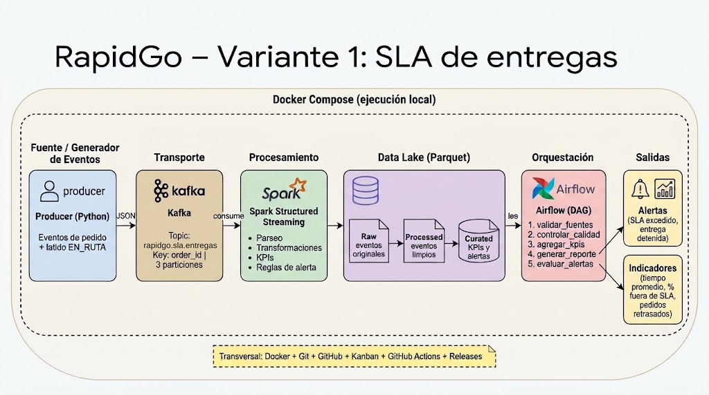

# RapidGo · Variante 1 — SLA de entregas

Flujo de datos Big Data de extremo a extremo para detectar retrasos e incumplimientos de los tiempos prometidos en las entregas de RapidGo. Proyecto final — Línea de Profundización I (Big Data) · Ingeniería de Sistemas y Computación · Facatativá.

Docente: Ing. Oscar Jobany Gomez Ochoa

| | |
|---|---|
| **Equipo** | Grupo 10 |
| **Integrantes** | Daniela Gomez Castro · Angela Maria Palacios Alonso · Ana Karina Arenales Bautista |
| **Variante** | 1 — SLA de entregas |
| **Versión actual** | En preparación (v0.1.0-foundation, Semana 1 · diseño y organización) |
| **Tablero Kanban** | https://github.com/users/AngelaP852/projects/4/views/1 |

## Problema de negocio

RapidGo necesita detectar retrasos e incumplimientos de los tiempos prometidos a sus clientes. Cuando un pedido llega después de la hora prometida baja la satisfacción del cliente, y si el retraso se detecta al final del día ya no hay forma de reaccionar. Detectarlo en minutos permite reasignar repartidores, avisar al cliente y medir el cumplimiento por zona.

**Valor de la solución:** indicadores por ventanas de 5 minutos y alertas automáticas por pedido, con trazabilidad completa en un Data Lake por capas (raw → processed → curated).

## Arquitectura



| Componente | Función en la variante |
|---|---|
| Producer (Python) | Genera eventos de cambio de estado de pedidos y un latido `EN_RUTA` cada 5 min |
| Kafka | Transporta los eventos en el topic `rapidgo.sla.pedidos` (key `order_id`, 3 particiones) |
| Spark Structured Streaming | Lee, valida el contrato, transforma, calcula KPIs por ventana y reglas de alerta |
| Data Lake (Parquet) | Capas raw → processed → curated, con checkpoint |
| Airflow | Valida la calidad, agrega, genera el reporte y evalúa alertas; reintentos y fallo controlado (Semana 3) |
| Docker, GitHub y GitHub Actions | Ejecución local, trazabilidad, integración continua y versiones |

## Contrato del evento

Evento de cambio de estado de un pedido. Detalle de campos y reglas en [`docs/contrato_evento.md`](docs/contrato_evento.md); ejemplos en `samples/eventos_pedido.json` (evento suelto) y `samples/eventos_ciclo_vida.jsonl` (ciclo de vida de dos pedidos).

```json
{
  "event_id": "EVT-000100",
  "team_id": "equipo-v1",
  "order_id": "ORD-000125",
  "status": "EN_RUTA",
  "zone": "Sur",
  "distance_km": 4.5,
  "created_at": "2026-10-21T14:10:00Z",
  "promised_at": "2026-10-21T14:55:00Z",
  "event_ts": "2026-10-21T14:25:00Z"
}
```

Estados: `CREADO → ASIGNADO → RECOGIDO → EN_RUTA → ENTREGADO`, más `DETENIDO` y `CANCELADO`.

## Kafka

| Topic | Clave | Particiones | Replicación | Retención |
|---|---|---|---|---|
| `rapidgo.sla.pedidos` | `order_id` | 3 | 1 | 7 días |

Valores propuestos; la justificación y la decisión final irán en el ADR-001 (pendiente).

## Indicadores y alertas (umbrales iniciales)

Detalle completo en [`docs/kpis_y_alertas.md`](docs/kpis_y_alertas.md).

| Indicador | Definición |
|---|---|
| K1 Tiempo promedio de entrega | promedio de `ENTREGADO − created_at` por ventana de 5 min y zona |
| K2 % fuera de SLA | pedidos entregados después de `promised_at` ÷ entregados × 100 |
| K3 Pedidos retrasados | pedidos abiertos con `ahora > promised_at` |

| Alerta | Regla |
|---|---|
| A1 SLA_EXCEDIDO | pedido sin `ENTREGADO`/`CANCELADO` y `ahora > promised_at + 5 min` |
| A2 ENTREGA_DETENIDA | pedido en `EN_RUTA` o `DETENIDO` sin eventos nuevos por más de 10 min |

El SLA se calcula como `promised_at = created_at + 10 min + 8 min × distance_km`, redondeado a múltiplos de 5 min. Los umbrales son hipótesis iniciales y se revisarán en la Semana 2 con datos reales.

## Ejecución local (estado de la Semana 1)

Pendiente: se documentará cuando el `docker-compose.yml` y el producer estén funcionando (Semana 2), con comandos realmente probados.

## Plan de versiones

| Versión | Semana | Contenido |
|---|---|---|
| v0.1.0-foundation | 1 | Arquitectura, contrato, KPIs y alertas, Kanban, ADR-001 |
| v0.2.0-streaming | 2 | Producer + Kafka + Spark + Data Lake + integración continua |
| v0.3.0-orchestration | 3 | DAG de Airflow, calidad, fallo controlado, CI ampliado |
| v1.0.0 | 4 | Quality gate, README final, video |

## Forma de trabajo

Issue → Branch → Pull Request → CI → Review → Merge → Release. No se hacen cambios funcionales directamente sobre `main`.

## Documentación

- Contrato del evento: [`docs/contrato_evento.md`](docs/contrato_evento.md)
- Indicadores y alertas: [`docs/kpis_y_alertas.md`](docs/kpis_y_alertas.md)
- Registros de decisiones (ADR): https://github.com/AngelaP852/Rapidgo-Grupo10/tree/main/docs/decisions


## Contribuciones (Semana 1)

| Integrante | Trabajo realizado |
|---|---|
| Ana Karina Arenales Bautista | Contrato JSON y ejemplos, KPIs y alertas, README inicial |
| Angela Maria Palacios Alonso | Creación del repositorio, particiones y topic, revisiones |
| Daniela Gomez Castro | Tablero Kanban |


Se actualizará cada semana. Enlace al video final: pendiente (Semana 4).
