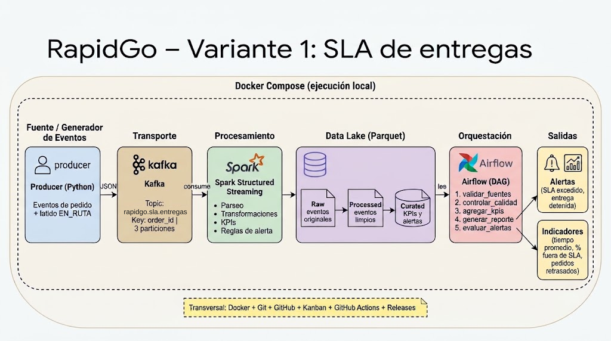

# RapidGo · Variante 1 — SLA de entregas

Flujo de datos Big Data de extremo a extremo para detectar retrasos e incumplimientos de los tiempos prometidos en las entregas de RapidGo. Proyecto final — Línea de Profundización I (Big Data) · Ingeniería de Sistemas y Computación · Facatativá.

Docente: Ing. Oscar Jobany Gomez Ochoa

| | |
|---|---|
| **Equipo** | Grupo 10 |
| **Integrantes** | Daniela Gomez Castro · Angela Maria Palacios Alonso · Ana Karina Arenales Bautista |
| **Variante** | 1 — SLA de entregas |
| **Versión actual** | v0.1.0-foundation (Semana 1 · diseño y organización) |
| **Tablero Kanban** | https://github.com/users/AngelaP852/projects/4/views/1 |

## Problema de negocio

RapidGo necesita detectar retrasos e incumplimientos de los tiempos prometidos a sus clientes. Cuando un pedido llega después de la hora prometida baja la satisfacción del cliente, y si el retraso se detecta al final del día ya no hay forma de reaccionar. Detectarlo en minutos permite reasignar repartidores, avisar al cliente y medir el cumplimiento por zona.

**Valor de la solución:** indicadores por ventanas de 5 minutos y alertas automáticas por pedido, con trazabilidad completa en un Data Lake por capas (raw → processed → curated).

## Arquitectura



| Componente | Función en la variante |
|---|---|
| Producer (Python) | Genera eventos de cambio de estado de pedidos y un latido `EN_RUTA` cada 5 min |
| Kafka | Transporta los eventos en el topic `rapidgo.sla.entregas` (key `order_id`, 3 particiones) |
| Spark Structured Streaming | Lee, valida el contrato, transforma, calcula KPIs por ventana y reglas de alerta |
| Data Lake (Parquet) | Capas raw → processed → curated, con checkpoint |
| Airflow | Valida la calidad, agrega, genera el reporte y evalúa alertas; reintentos y fallo controlado (Semana 3) |
| Docker, GitHub y GitHub Actions | Ejecución local, trazabilidad, integración continua y versiones |

## Contrato del evento

Evento de cambio de estado de un pedido. Detalle de campos y reglas en [`docs/contrato_evento.md`](docs/contrato_evento.md); ejemplos en `samples/eventos_pedido.json` (evento suelto), `samples/eventos_ciclo_vida.jsonl` (ciclo de vida de dos pedidos) y `samples/eventos_entrega_detenida.jsonl` (pedido que termina en `DETENIDO`).

```json
{
  "event_id": "EVT-000100",
  "team_id": "equipo-v1",
  "order_id": "ORD-000125",
  "status": "EN_RUTA",
  "zone": "Centro",
  "distance_km": 4.5,
  "created_at": "2026-10-21T14:00:00Z",
  "promised_at": "2026-10-21T14:45:00Z",
  "event_ts": "2026-10-21T14:20:00Z"
}
```

Estados: `CREADO → ASIGNADO → RECOGIDO → EN_RUTA → ENTREGADO`, más `DETENIDO` y `CANCELADO`.

## Kafka

| Topic | Clave | Particiones | Replicación | Retención |
|---|---|---|---|---|
| `rapidgo.sla.entregas` | `order_id` | 3 | 1 | 7 días |

Valores propuestos; la justificación y la decisión están en el [ADR-001](docs/decisions/ADR-001-key-y-particiones-kafka.md). La distribución real por partición se medirá en la Semana 2.

## Indicadores y alertas (umbrales iniciales)

Detalle completo en [`docs/kpis_y_alertas.md`](docs/kpis_y_alertas.md).

| Indicador | Definición |
|---|---|
| K1 Tiempo promedio de entrega | promedio de `ENTREGADO − created_at` por ventana de 5 min y zona |
| K2 % fuera de SLA | pedidos entregados después de `promised_at` ÷ entregados × 100 |
| K3 Pedidos retrasados | pedidos abiertos con `ahora > promised_at` |

| Alerta | Regla |
|---|---|
| A1 SLA_EXCEDIDO | pedido sin `ENTREGADO`/`CANCELADO` y `ahora > promised_at + 5 min` |
| A2 ENTREGA_DETENIDA | pedido en `EN_RUTA` o `DETENIDO` sin eventos nuevos por más de 10 min |

El SLA se calcula como `promised_at = created_at + 10 min + 8 min × distance_km`, redondeado al múltiplo de 5 min más cercano. Los umbrales son hipótesis iniciales y se revisarán en la Semana 2 con datos reales.

## Ejecución local

Requisitos: Docker Desktop abierto y Python 3.11 con `python -m pip install -r requirements.txt`. Los comandos son de PowerShell, desde la raíz del repo.

**1. Levantar Kafka y Spark**

```
docker compose up -d
docker compose logs -f spark
```

Kafka crea el topic `rapidgo.sla.entregas` con 3 particiones. Spark tarda 1 o 2 minutos en instalar sus paquetes. Cuando el log muestre `Streams iniciados. Esperando datos...`, salir con Ctrl + C (Spark sigue corriendo). Spark lee desde `latest`, así que los eventos se publican **después** de este paso.

**2. Publicar eventos**

Primer lote: 3 pedidos que quedan `DETENIDO` y nunca se cierran.

```
python producer/producer.py --n-pedidos 3 --seed 2 --inicio 2026-10-21T14:00:00Z --p-retrasado 0 --p-detenido 1 --p-cancelado 0
```

Segundo lote: 3 pedidos sanos horas después, con otros ids. Hace avanzar el watermark de Spark, que es lo que dispara las alertas por silencio.

```
python producer/producer.py --n-pedidos 3 --seed 9 --inicio 2026-10-21T18:00:00Z --p-retrasado 0 --p-detenido 0 --p-cancelado 0 --primer-pedido 500 --primer-evento 5000
```

**3. Ver las alertas** (esperar 1 minuto)

```
python -c "import pandas as pd; print(pd.read_parquet('datalake/curated/alertas').sort_values(['order_id','alerta']).to_string())"
```

Resultado esperado: 6 filas, con `A1_SLA_EXCEDIDO` y `A2_ENTREGA_DETENIDA` para ORD-000001, ORD-000002 y ORD-000003, y ninguna para los pedidos sanos ORD-000500 a ORD-000502. Si no aparece nada, publicar otro lote sano con `--inicio 2026-10-21T19:00:00Z --primer-pedido 510 --primer-evento 5100` y esperar otro minuto.

Los KPIs quedan en `datalake/curated/kpis` y los eventos inválidos en `datalake/raw/invalidos`.

**4. Apagar y limpiar**

```
docker compose down
Remove-Item -Recurse -Force datalake\checkpoints, datalake\curated, datalake\processed, datalake\raw -ErrorAction SilentlyContinue
```

No usar `-v` en `docker compose down`. Hay que borrar las carpetas del Data Lake entre pruebas para no mezclar checkpoints viejos.


## Plan de versiones

| Versión | Semana | Contenido |
|---|---|---|
| v0.1.0-foundation | 1 | Arquitectura, contrato, KPIs y alertas, Kanban, ADR-001 |
| v0.2.0-streaming | 2 | Producer + Kafka + Spark + Data Lake + integración continua |
| v0.3.0-orchestration | 3 | DAG de Airflow, calidad, fallo controlado, CI ampliado |
| v1.0.0 | 4 | Quality gate, README final, video |

## Forma de trabajo

Issue → Branch → Pull Request → CI → Review → Merge → Release. No se hacen cambios funcionales directamente sobre `main`.

## Documentación

- Contrato del evento: [`docs/contrato_evento.md`](docs/contrato_evento.md)
- Indicadores y alertas: [`docs/kpis_y_alertas.md`](docs/kpis_y_alertas.md)
- Registros de decisiones (ADR): [`docs/decisions/`](docs/decisions/)
- Checkpoints semanales: [`docs/checkpoints/`](docs/checkpoints/)

## Tabla de Contribuciones y Roles de Equipo

| Integrante | Responsabilidades | Issues principales | Pull Requests principales |
|---|---|---|---|
| **Daniela Gómez Castro** | Tablero Kanban e Issues; CI con GitHub Actions; pruebas del contrato, de la fórmula del SLA y del producer; casos de prueba de las alertas; ejecución local en el README. | #9, #30, #35, #88, #93, #95 | #76 (ci.yml), #77 (tests de contrato y SLA), #84 (CI sin tolerancia), #89 (tests producer), #94 (casos de alertas), #96 (README de ejecución) |
| **Angela María Palacios Alonso** | Repositorio y estructura; Docker Compose con Kafka; topic, key y particiones (ADR-001, ADR-002); producer y verificación de particiones; evidencias de la Semana 2. | #8, #29, #31, #33, #41, #43 | #19 (ADR-001), #20 (compose Kafka), #25 (checkpoint 1), #80 (producer y particiones), #81 (check_partitions), #99 (evidencias), #100 (ADR-002) |
| **Ana Karina Arenales Bautista** | Contrato JSON y ejemplos; KPIs y alertas; README inicial; job de Spark Streaming (validación, transformaciones, KPIs, alertas con estado); DAG de Airflow y funciones de calidad. | #1, #2, #3, #32, #34, #36, #38, #39 | #4 (README), #5 (contrato), #62 (alertas estado), #92 (job de Spark); en revisión: #85, #86, #87, #90 |


Se actualizará cada semana. Enlace al video final: pendiente (Semana 4).
